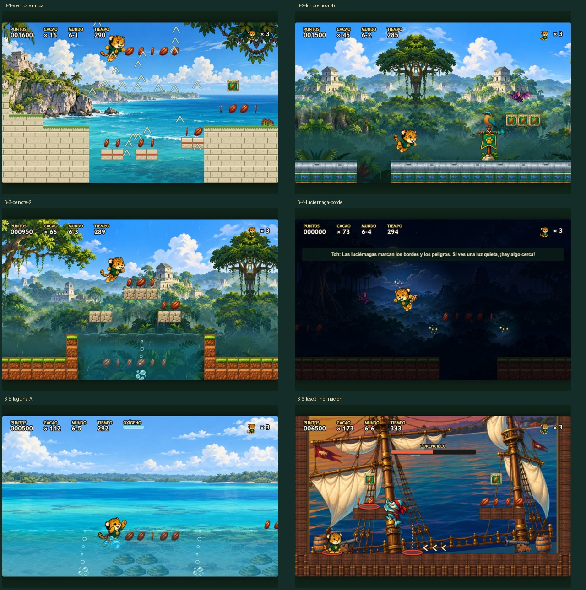
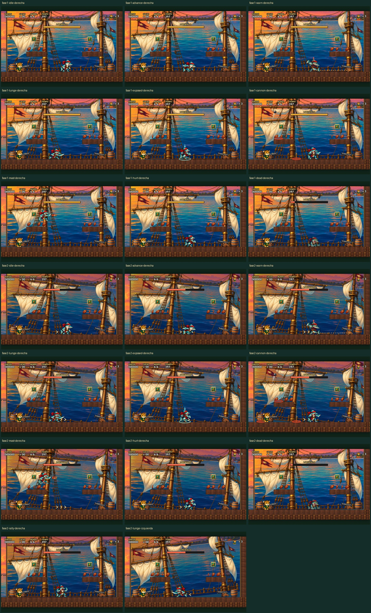

# Revisión del Mundo 6 y Lorencillo

Revisión realizada el 17 de octubre de 2026 sobre el Mundo 6 existente. Los ids y el formato de progreso se conservan.

## Repaso visual



| Nivel | Revisión y resultado |
|---|---|
| 6-1 · Tulum | Acantilados, viento horizontal y térmica visibles; salto sobre la grieta, checkpoint y meta completados. Se conserva el arte existente. |
| 6-2 · Tulum Aeropuerto | Techo y costado sustituyen el dibujo simple por cuatro variantes pintadas de cada material. Huecos y cajas conservan su geometría. Recorrido con cámara automática, checkpoint y meta; también en móvil vertical. |
| 6-3 · Felipe Carrillo Puerto | Lluvia, ceibas, tres cenotes y lectura de las orillas revisados. Nado, aire, checkpoint y meta activos. Se conserva el arte existente. |
| 6-4 · Limones | Oscuridad y luciérnagas revisadas junto a bordes, plataformas y enemigos. Recorrido del foso largo, checkpoint y meta completados. |
| 6-5 · Bacalar | Agua, silueta de nado y cúpulas revisadas. Nado por las dos lagunas; pisar un estromatolito produce aviso y resta exactamente 500 puntos sin quitar vida. |
| 6-6 · Chetumal | Fondo propio de bahía al atardecer, velas y jarcias pintadas, cubierta y casco nuevos. Recorrido de canales y checkpoint; Lorencillo pasa por sus dos fases, muere, abre el muro y se alcanza la meta. |

No faltaban imágenes de los enemigos usados en estos niveles. Las carencias principales estaban en materiales del tren, escenario de Chetumal y acciones específicas de Lorencillo.

## Lorencillo: combate exigente con avisos



- **Ocho PV y dos fases completas.** La transición llega a cuatro PV con un rugido de 1,4 segundos y limpieza de peligros.
- **Fase 1:** una estocada a 460 px/s, aviso de 0,8 s; dos cañonazos; trepa al mástil y lanza cangrejos desde arriba.
- **Fase 2:** dos estocadas a 560 px/s con un aviso de 0,65 s por carrera; tres cañonazos, salva durante el mástil e inclinación de cubierta. Respiro entre ataques de 0,5 s.
- **Respuesta:** esperar la última estocada, saltar y pisar la espalda, o acertar dos veces con fuego/pelota durante la misma apertura. Ventanas de 2,2/1,9 s; un PV como máximo. Se corrige la acumulación de impactos entre aperturas caducadas.
- **Arena:** las cofas sirven de refugio temporal y también reciben impactos. Las marcas señalan la altura real de la explosión y quedan fijas al anunciarse. Las salvas dejan un bloque libre entre áreas de impacto incluso junto a los bordes.
- **Lectura:** flecha de estocada, anillo y flecha sobre la espalda expuesta, dirección de deriva y guías verticales de cañón. Se reutilizan bala y humo pintados. El alcance del sable tiene colisión propia.
- **Poses:** guardia, avance, estocada, espalda expuesta, orden de cañón, trepar, lanzamiento y rugido nuevos; preparación y derrota del atlas histórico. Escala común y apoyo calibrado en las aletas; aislamiento de siluetas para excluir restos de otras poses.

## Arte y prompts completos

Generado con la herramienta integrada **image_gen**, exportado a WebP sin pérdidas y verificado píxel a píxel con [el importador](../../import_world6_art.py). Se conservan los PNG originales. El atlas de materiales contiene cuatro variantes para cada uno de sus cuatro materiales.

| Recurso en el juego | Original | Prompt final |
|---|---|---|
| `public/assets/bosses/lorencillo-acciones.webp` | [Ocho acciones](../../nuevos/jefes/lorencillo-acciones.png) | [Prompt de acciones](../../nuevos/jefes/lorencillo-acciones.prompt.txt) |
| `public/assets/escenarios/jarcia-lorencillo.webp` | [Jarcias](../../nuevos/escenarios/jarcia-lorencillo.png) | [Prompt de jarcias](../../nuevos/escenarios/jarcia-lorencillo.prompt.txt) |
| `public/assets/backgrounds/bay.webp` | [Bahía](../../nuevos/escenarios/bahia-chetumal.png) | [Prompt de bahía](../../nuevos/escenarios/bahia-chetumal.prompt.txt) |
| `public/assets/terreno/vagon-costa-maya.webp` | [Vagones y tablones](../../nuevos/terreno/vagon-costa-maya.png) | [Prompt de materiales](../../nuevos/terreno/vagon-costa-maya.prompt.txt) |

Registros: `src/data/world6Art.ts`, `lorencilloArt.ts` y `terrainSprites.ts`. Cada WebP nuevo tiene su atlas JSON junto al archivo.

## Verificación y alcance

- `npm run build`: correcto. Vite conserva el aviso de tamaño del bundle JavaScript superior a 500 kB.
- `npm test`: **102 archivos correctos; 1657 pruebas correctas, 7 fallos esperados y 85 omitidas**.
- [Recorridos de los seis niveles](recorridos.json): todos terminan con checkpoint y meta; Lorencillo llega a cero PV y la salida queda abierta. Sin errores de navegador.
- [Veinte escenas del jefe y móvil](lorencillo/informe.json): ambas fases, ambas orientaciones de estocada y todas las acciones; móvil de 844 × 390 y 390 × 844, cinco botones táctiles y sin desbordamiento horizontal.
- Cobertura nueva: `bosses/lorencillo/difficulty.test.ts` y `data/world6Art.test.ts`. Se comprueban avisos, doble estocada, transición, alcance del sable, caducidad del fuego, cofas, separación de marcas, altura de lanzamiento, recortes, anclas y precarga.

Los recorridos usan contacto protegido; oxígeno, terreno, hoyos y cámara siguen activos. Los ocho pisotones sobre Lorencillo se preparan colocándolo debajo de Temayin solo durante una ventana válida; el motor resuelve el contacto y el daño. Las veinte escenas se preparan para comprobar dibujo y legibilidad. **Esta verificación no certifica la dificultad con un jugador humano ni demuestra una victoria sin asistencia.** Los cambios aumentan la presión y eliminan el refugio permanente, manteniendo avisos y aperturas verificables.

Reproducción, con Vite en `http://127.0.0.1:5197` y Python con Pillow y Playwright:

```sh
python imagenes/import_world6_art.py
python imagenes/verify_world6.py --sin-servidor
python imagenes/verify_lorencillo_visuals.py
```
